# FrakMC Quick Start

FrakMC turns the Mandelbrot and Julia sets into music for up to six MIDI instruments, played on
your own synthesizers through Web MIDI. It is an independent project informed by research into
Hugh McDowell's *Fractal Music Composer 2* for the Atari ST, and it follows that program's musical
model and workflow — but it is not that program, nor an official port of it.

Everything happens in your browser. Nothing is uploaded anywhere.

> **Three things to remember.** On any number: **left click = down, right click = up** (the wheel
> and arrow keys work too). **Space** stops playing. **PANIC** (top right) silences everything.

---

## 1. Open FrakMC

Open it in Chrome, Edge, Opera or Firefox and allow MIDI devices if asked. (Safari has no Web
MIDI: FrakMC still runs, you can watch the notes in the monitor and save MIDI files.)

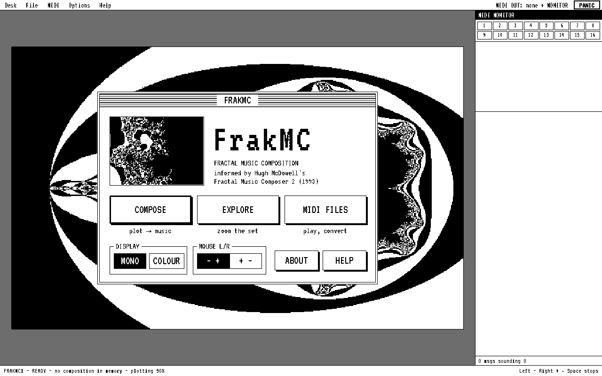

The menu offers:

- **COMPOSE** — turn the plot into music.
- **EXPLORE** — zoom into the Mandelbrot set and keep new plots.
- **MIDI FILES** — inspect, play, filter and convert MIDI files.

Below them: **DISPLAY** (two or four colours), **MOUSE L/R** (which button raises a value),
**ABOUT** and **HELP**. Around the screen are the menu bar (Desk, File, MIDI, Options, Help), the
**PANIC** button, the **MIDI MONITOR** (every message FrakMC sends, with channel lights and a
scrolling piano roll) and a status line.

## 2. Connect a synthesizer

1. Plug in your MIDI interface or USB synth (before or after opening FrakMC — it notices).
2. Choose it in the **MIDI** menu. FrakMC remembers your choice.
3. The first set-up uses **channels 1–4** for four pitched parts (two melodies, a sustained
   middle part and a bass) and **channel 10** for two General MIDI drum parts. Set your synth to
   match, or change the **CH** column.
4. Press **LO** or **HI** on a track's row to hear the bottom and top of its range — a quick
   check that the right sound answers on the right channel.

**PROGRAM** sends a program (patch) change to any channel. Program changes are not stored in
saved MIDI files.

No synth? Leave the output on *No MIDI output* — the monitor still shows everything, and you can
save MIDI files to play elsewhere.

## 3. The Composer

Choose **COMPOSE**.

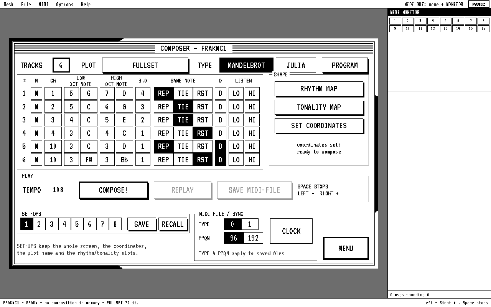

Each row is a **track**; **TRACKS** sets how many are used.

| Column | What it does |
|---|---|
| **M** | Mute the track. |
| **CH** | MIDI channel 1–16. |
| **LOW**, **HIGH** | The range: an octave (1–8) and a note. Octave 5 starts at middle C. |
| **S.O** | Scale-base octave: which row of the scale pattern the track's lowest octave uses (§6). |
| **SAME NOTE** | When a note repeats: **REP** plays it again, **TIE** holds it, **RST** leaves a gap. |
| **D** | Ignore scales and transposition — for drum parts. |
| **LO / HI** | Listen to the range. |

Along the top: the **PLOT** in use and the fractal **TYPE** (Mandelbrot or Julia). On the right:
**RHYTHM MAP**, **TONALITY MAP** and **SET COORDINATES**. Below: **TEMPO** (type it, scroll it or
click it), **COMPOSE!**, **REPLAY**, **SAVE MIDI-FILE**; eight **SET-UPS** slots with SAVE and
RECALL; and the saved file's options — **TYPE** 0 (one track) or 1 (a track per part),
**PPQN** 96 or 192 (192 plays the same lengths twice as fast) — and **CLOCK** (send MIDI clock).

## 4. Compose your first piece

The first set-up is ready to go:

1. Press **COMPOSE!** (or Return).
2. Press Return again (or START) to begin.
3. Listen. **Space**, or a click on the screen, stops.

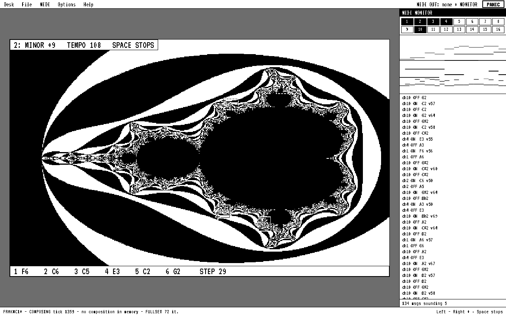

While it plays you see the plot with each track's two **boxes** outlined and a small cross where
each box is being read. The top line shows the current tonality (scale and transposition) and the
tempo (**+**/**−** change it while playing); the bottom line shows each track's latest note.

When you stop, what you heard is the **composition in memory**: **REPLAY** plays it again at the
current tempo and **SAVE MIDI-FILE** saves it. Composing again replaces it.

## 5. Why it sounds like that

FrakMC follows the model of the original program, worked out from its documentation and from
examining the program itself (see [BEHAVIOUR.md](BEHAVIOUR.md)).

**The picture is a map of escape speeds.** Every pixel is a number *c*. FrakMC repeats
z → z² + c and counts how quickly z grows past a limit. The black and white bands are those
counts, alternating; the large black area is where z never escapes.

**Each track reads two boxes, one pixel per note.** Every track has a **note box** and a
**length box**. When a track needs a note, FrakMC takes the next pixel of its note box — down a
column, then the next column, round again at the end — and recomputes that pixel's count:

- **Pitch** — the count walks up through the track's range and back down again, so smoothly
  changing counts make rising and falling lines. Inside the black area the count is zero, so you
  always get the **lowest note**.
- **Loudness** — the closer a pixel is to the set, the **louder** the note. Loudness is smoothed
  from note to note.

The length box works the same way, choosing one of the track's lengths; inside the black area it
always picks **the first length**.

So areas near the edge of the set, where the count changes from pixel to pixel, make the liveliest
music; wide bands give repeated notes; the black area gives one note over and over. Boxes of
different sizes make the tracks drift against each other, so patterns recur but rarely line up.

In Mandelbrot mode nothing is random: the same plot, boxes and settings always make the same piece.

## 6. Shape the music

### Rhythm Map

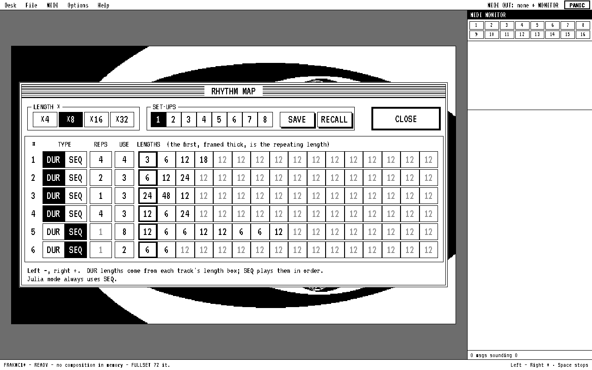

Each track has up to 16 lengths, all multiplied by **×4, ×8, ×16 or ×32**. With ×8 at 96 PPQN,
**12 is a crotchet**, 6 a quaver, 3 a semiquaver, 24 a minim, 8 a triplet crotchet. **USE** says
how many of the lengths the track uses.

- **DUR** — the length box picks one of the lengths. The first length (thick frame) is special:
  when it is picked it repeats **REPS** times, giving a run of equal notes.
- **SEQ** — the lengths are played in order, round and round, with an accent each time the
  sequence starts again. Julia mode always uses SEQ.

### Tonality Map

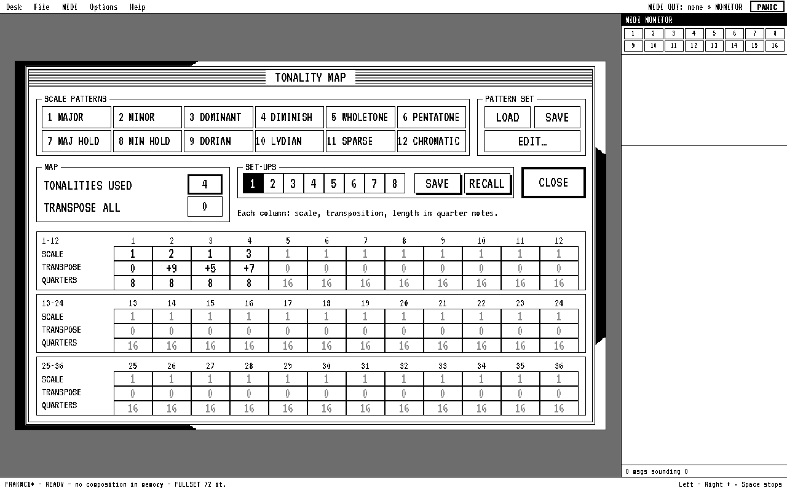

Each column is a **tonality**: a **scale** pattern (1–12), a **transposition** in semitones and
a length in **quarter notes**. FrakMC plays tonalities 1, 2, 3 … up to **TONALITIES USED** and
then starts again — the piece's chord progression. **TRANSPOSE ALL** shifts the whole map. The
first set-up moves through four chords, two bars each.

### Scale patterns

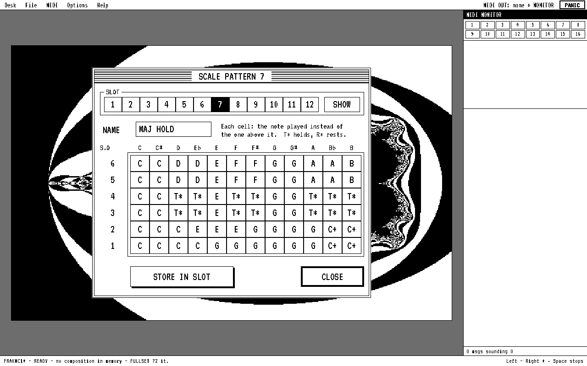

Click a pattern's name (or **EDIT…**). A scale pattern doesn't list notes; it says, for every
chromatic note in each **octave row (S.O 1–6)**, which note to play instead. Low rows usually
keep only a few notes (good for basses), high rows more. **T\*** holds the previous note, **R\***
rests. Change a cell with left/right clicks, then **STORE IN SLOT**. A track's **S.O** chooses
which row its lowest octave reads: a bass on S.O 1 plays mostly roots and fifths; a melody on S.O 4
gets fuller scales.

**LOAD** and **SAVE** read and write the 12 patterns as an `.SCA` file, the same format as the
original program's scale sets.

## 7. Choose where the music comes from

Press **SET COORDINATES** and choose **REDRAW**.

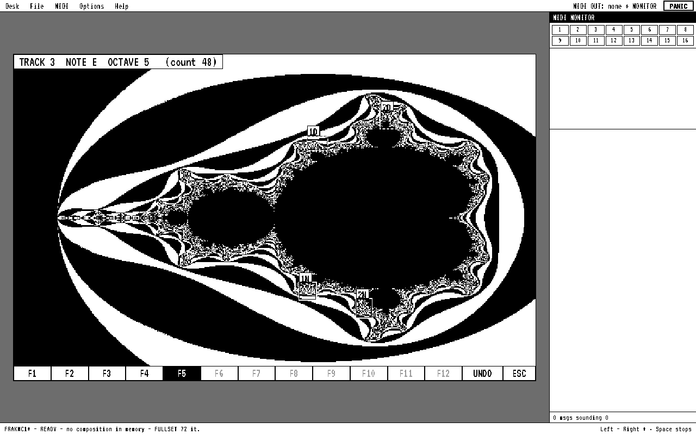

The line at the top says which box to draw, e.g. `TRACK 3: DRAG THE NOTE BOX [F5]`.

- **Drag** a box with the left button.
- **Hold the right button** and move to see what any pixel would give, e.g.
  `TRACK 3  NOTE Eb  OCTAVE 4`.
- **F1–F12** (or the buttons along the bottom) reuse a box you've already drawn: track 1's note
  box is F1, its length box F2, track 2's note box F3 … A note box can also serve as a length box.
- **Backspace** undoes the last box; **Esc** leaves without changes.

After the last box you return to the Composer, ready to compose.

## 8. Julia mode

Choose **JULIA**, then **SET COORDINATES**, and **click once per track** on the plot. Each point
chooses a Julia set; points on or near the edge of the Mandelbrot set give the richest shapes.

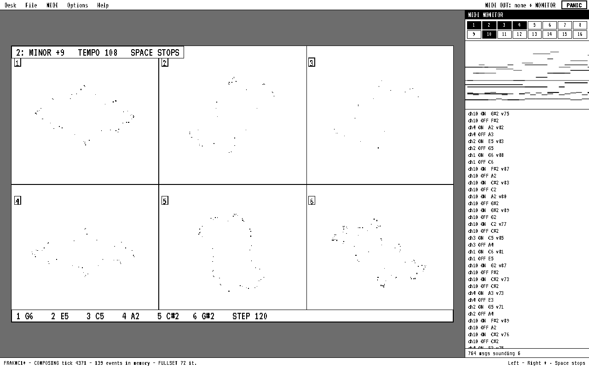

While composing, FrakMC draws the six Julia sets dot by dot. **Left to right is pitch** (the
leftmost dots are the bottom of the range), **height is loudness**. Each dot is found by choosing
between two square roots, and that choice comes from a pseudo-random sequence, so every Julia
composition is different. Options ▸ *Reset Julia random generator* restarts the sequence.

Julia mode turns your click into a point with a fixed rule that fits the default plot exactly.
With a zoomed plot, Options ▸ *Julia c from plot coordinates* uses the point you actually clicked.

## 9. Explore the Mandelbrot set

From the menu choose **EXPLORE**.

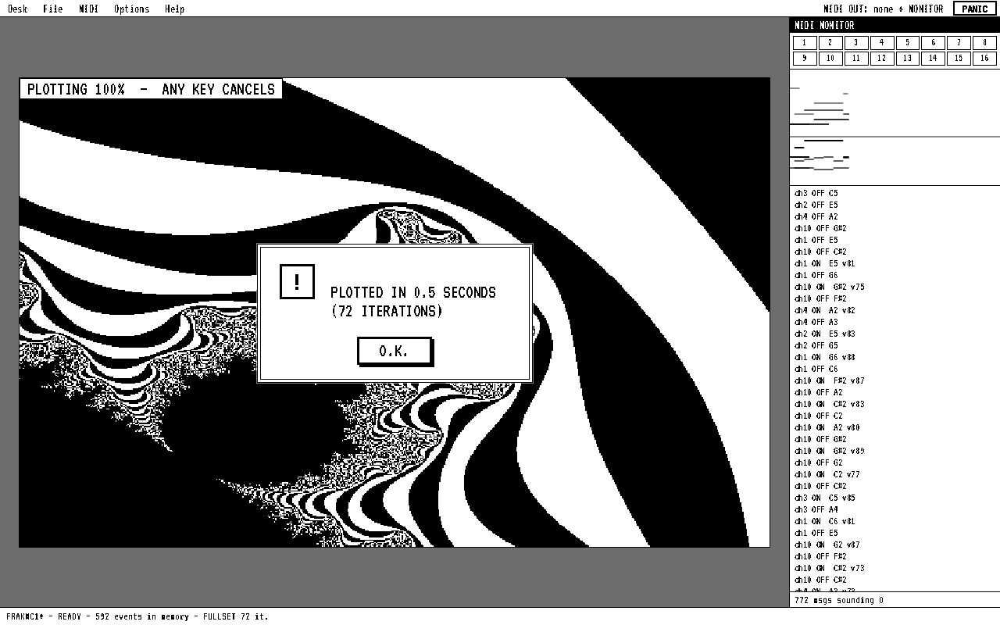

- **ZOOM**: drag a box around an interesting area, choose the detail (**72, 144 or 288**
  iterations — more shows finer edges) and whether to name the plot straight away. It takes about
  a second.
- **BROWSE**: look at plots you've kept.
- **DONE**: offers to keep a new plot and to compose from it.

In the Composer, the **PLOT** button switches plots. A new plot needs new coordinates. Very deep
zooms stop when the plot reaches the limit of its precision.

## 10. Save, reload and export

- **Your work is saved automatically** in this browser; reopen FrakMC and it is all there,
  including the composition in memory.
- **File ▸ Save as…** keeps a named copy; **File ▸ Open…** brings it back.
- **File ▸ Export document** saves everything (set-ups, scales, plot, slots and the composition)
  as a `.frakmc.json` file; **File ▸ Import…** reads it back. Import also reads data files from
  your own copy of the original program (`.DMP` plots, `.SCA` scale sets and the `.REC` set-up
  files).
- **SET-UPS** slots on the Composer, Rhythm Map and Tonality Map keep alternatives inside the
  document. The first document has examples in slots 1, 2 and 5 (slot 5 is a Julia set-up).
- **SAVE MIDI-FILE** saves the composition in memory as a Standard MIDI File for any sequencer or
  DAW. **File ▸ Render 64 bars to memory** composes without waiting, ready to save.

## 11. MIDI files

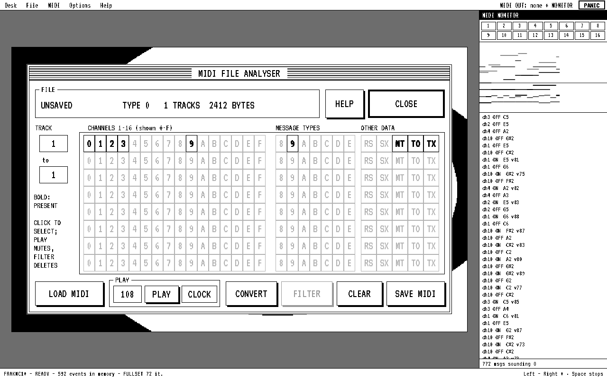

**MIDI FILES** opens on the composition in memory (or **LOAD MIDI** any Standard MIDI File). Each
row is a track; **bold** boxes show which channels, message types and other data it contains.
Click bold boxes to select them: **PLAY** leaves them out, **FILTER** deletes them, **CLEAR**
deselects. **CONVERT** switches between type 0 and type 1 (type 0 → 1 gives each channel its own
track). **SAVE MIDI** saves the result.

## 12. Stopping safely

- **Space** stops composing, replaying or playing, and every note that was started is ended.
- **PANIC** also sends All Sound Off, All Notes Off and sustain-off on all 16 channels, plus a
  note-off for every note on the channels in use, for synths that ignore All Notes Off.
- Changing MIDI output, opening another document or closing the tab also ends sounding notes.

## Colours

**DISPLAY** on the menu switches between two and four colours; **Desk ▸ Colours…** sets each colour
(0–7 per red, green and blue, as on the ST) and has presets, including light-on-dark looks.

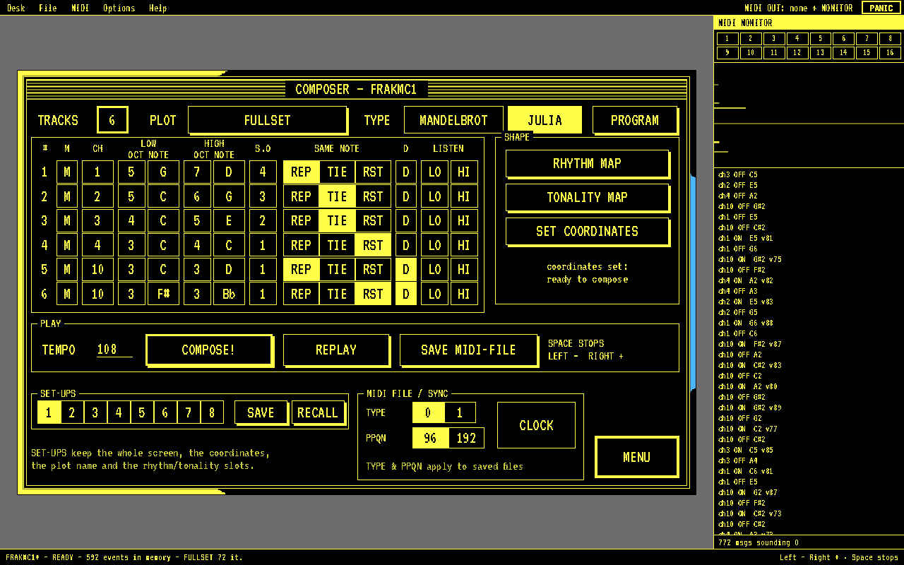

## Keys

| Key | Action |
|---|---|
| Left / right click | value down / up (swappable) |
| Wheel, arrow keys | value down / up (Shift: ×10) |
| Return | compose / confirm |
| Space | stop |
| + / − while playing | tempo |
| F1–F12 | reuse a box (Set Coordinates) |
| Backspace / U | undo a box |
| Hold right button on the plot | examine a point |
| Esc | back / cancel |

## Timing

Notes are sent with precise timestamps about a tenth of a second ahead, from a timer in a
background worker, and fractal plotting runs in a separate worker. In testing, composing while
plotting thirty high-detail plots in a row, with the page deliberately stalled 40 ms at a time,
never delayed a note.

## About FrakMC

FrakMC is an independent browser-based fractal music composition project inspired by and informed
by Hugh McDowell's Fractal Music Composer 2 for the Atari ST. It is independently implemented and
is not an official port or continuation of Fractal Music Composer, and it is not affiliated with or
endorsed by Hugh McDowell or any historical publisher or distributor of FMC/FMC2. The original
software, documentation and associated historical materials are not distributed with FrakMC.
